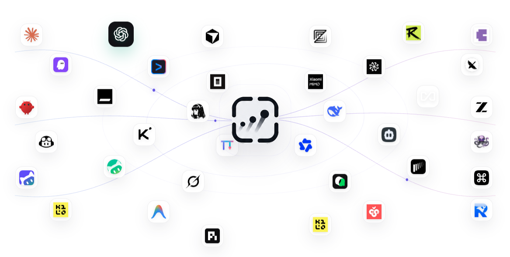
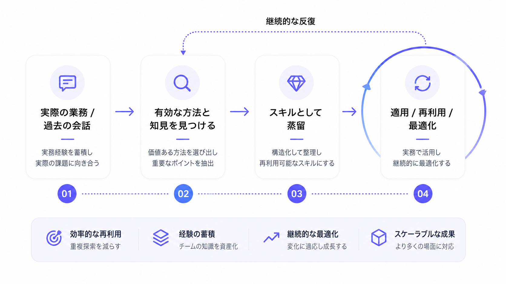
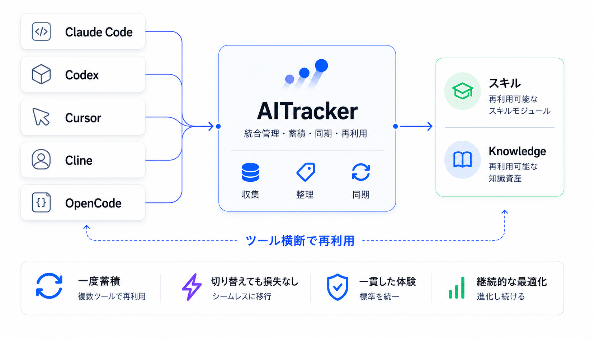
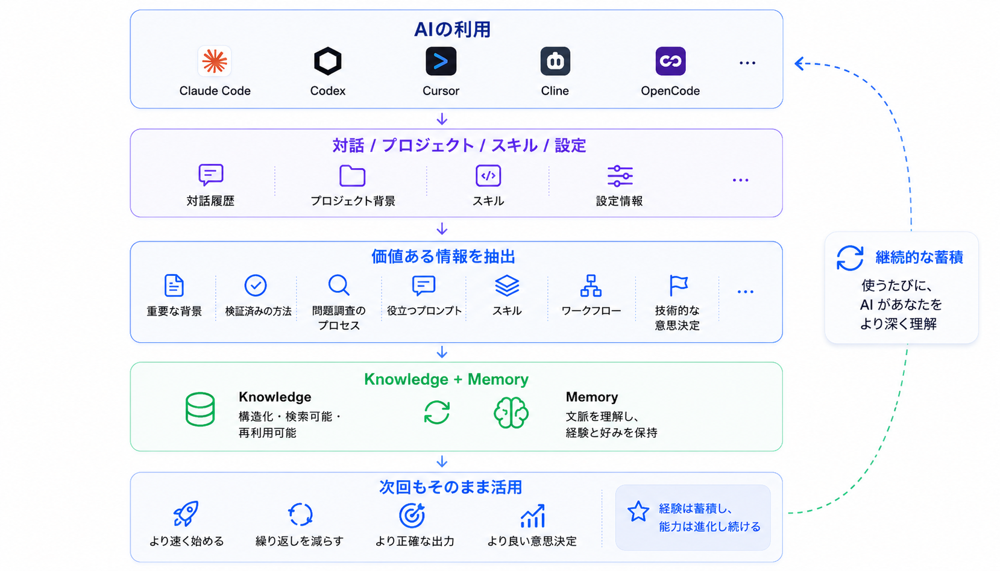
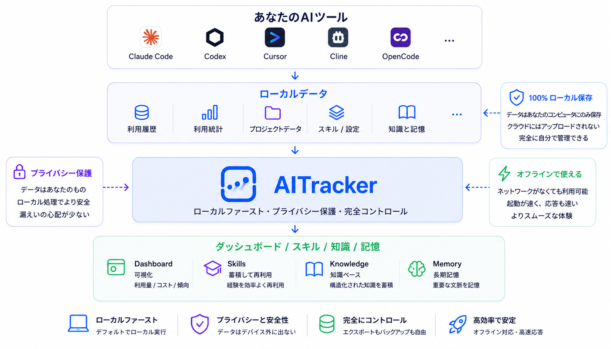
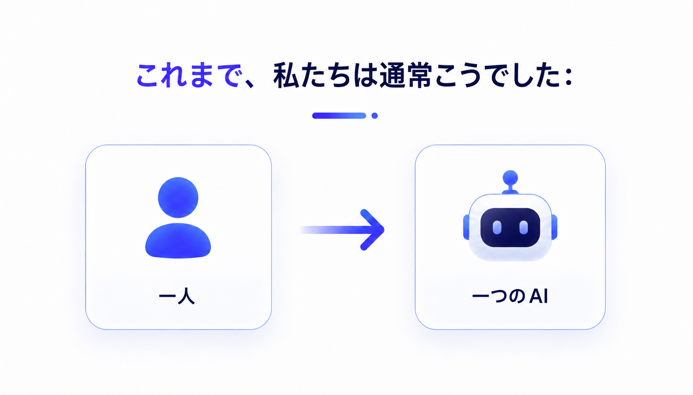
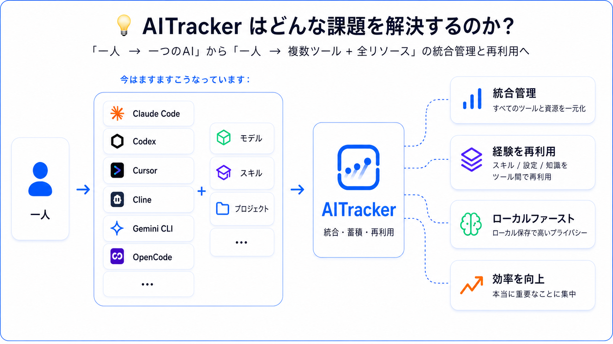

# AITracker

<p align="center">
  
</p>

<p align="center">
  <a href="https://github.com/estelwalks/aitracker/stargazers"></a>
  <a href="https://github.com/estelwalks/aitracker/blob/main/LICENSE"></a>
  <a href="https://github.com/estelwalks/aitracker/releases/latest"></a>
</p>

<p align="center">
  <a href="../README.md">English</a> | <a href="README_CN.md">简体中文</a> | <a href="README_JA.md">日本語</a> | <a href="README_KO.md">한국어</a>
</p>

> **どれだけトークンを使い、いくら費やし、どのAgentツールが最も使いやすいかを、一目で把握。**

AITrackerは、**オープンソースでローカル動作するAIワークスペース**です。

Claude Code、Codex、CursorなどのAIツールにおけるトークン、コスト、利用傾向を自動的に追跡し、Skillsやよく使う設定を一元管理します。実際の作業や利用履歴からSkillsを蒸留し、個人ナレッジベースと長期記憶を構築することで、AIの利用を次回も再利用できる能力へと変えていきます。

**オープンソース · ローカルファースト · アカウント不要**

> 注：本文中の図は元の図版をそのまま使用しています。画像内に含まれる中国語テキストは原文のままで、本文のMarkdownはすべて日本語に翻訳しています。

---

## ✨ なぜAITrackerが必要なのか？

AIツールはますます増えています。

Claude Code、Codex、Cursor、Cline、Gemini CLI、OpenCode……

しかし、ツールが増えるにつれて、新たな問題も生まれます。

- 自分は実際にどれだけAIを使ったのか？
- トークンと費用はどこに使われているのか？
- どのツール、どのモデルが自分に最適なのか？
- Skillsなどの設定が、あちこちに分散していないか？
- 別のAIツールに乗り換えるたび、設定をやり直していないか？
- 今日うまくいった方法を、次回もそのまま使えるか？
- AIが自分のプロジェクトや長期的な作業経験を覚えてくれないか？

**AITrackerは、これらを一つの場所に集約します。**

AIの利用状況を把握し、AIの能力を管理し、Skillsを蒸留し、知識と長期記憶を蓄積する。AITrackerは、AIを一度きりの道具で終わらせません。

---

## 🚀 クイックスタート

AITrackerはElectron、TanStack Start、React、TypeScriptで構築されたデスクトップアプリです。セキュリティスキャンには npm 公開済みの `@estelwalks/agent-threat-scanner` パッケージを使用するため、クローン後はルートの依存関係をインストールすれば開発できます。

### 必要環境

- Node.js 24 以降
- npm 10 以降
- macOS、Windows、Linux（完全なデスクトップ体験）

```bash
git clone https://github.com/estelwalks/aitracker.git
cd aitracker
npm ci
npm run dev:desktop
```

ブラウザ開発サーバーだけを起動する場合は、`npm run dev`を実行します。

### インストール

最新リリースのインストーラーを直接ダウンロードすることもできます。以下のリンクは
リリースごとに変わることはなく、常に最新のリリースを指します。インストーラーの
ファイル名にバージョンは含まれず、リリースごとに変わるのはタグだけです。

- macOS（Apple Silicon）：
  [AITracker-macOS-arm64.dmg](https://github.com/estelwalks/aitracker/releases/latest/download/AITracker-macOS-arm64.dmg)
- macOS（Intel）：
  [AITracker-macOS-x64.dmg](https://github.com/estelwalks/aitracker/releases/latest/download/AITracker-macOS-x64.dmg)
- Windows（x64）：
  [AITracker-Windows-x64.exe](https://github.com/estelwalks/aitracker/releases/latest/download/AITracker-Windows-x64.exe)
- Windows（ARM64）：
  [AITracker-Windows-arm64.exe](https://github.com/estelwalks/aitracker/releases/latest/download/AITracker-Windows-arm64.exe)
- Linux（x64、AppImage）:
  [AITracker-Linux-x64.AppImage](https://github.com/estelwalks/aitracker/releases/latest/download/AITracker-Linux-x64.AppImage)
- Linux（x64、Debian/Ubuntu パッケージ）:
  [AITracker-Linux-x64.deb](https://github.com/estelwalks/aitracker/releases/latest/download/AITracker-Linux-x64.deb)
- Linux（x64、Fedora/RHEL パッケージ）:
  [AITracker-Linux-x64.rpm](https://github.com/estelwalks/aitracker/releases/latest/download/AITracker-Linux-x64.rpm)

各リリースにはそのバージョンの `release-metadata.json` と `checksums.txt` が添付され、
正確なバージョンと SHA-256 が記録されています。特定のビルドを再現したい場合は、
`latest` ではなく該当タグのリリースからダウンロードしてください。

すべてのリリースは [Releases ページ](https://github.com/estelwalks/aitracker/releases/latest) で確認できます。

以下のコマンドはmacOS、Windows、Linuxの正式版をインストールするためのものです。
正式版と各パッケージマネージャーのメタデータが公開された後に利用できます。

#### npx（macOS / Windows / Linux）

Node.jsとnpmをインストール済みの場合は、次のコマンドを実行します。

```bash
npx --yes @estelwalks/aitracker@latest
```

このコマンドはデスクトップインストーラーをダウンロードして開きます。`@latest` は常に
最新の正式版に追従するため、書き換える必要はありません。特定のビルドを再現したい場合は
バージョンを固定してください（`@estelwalks/aitracker@1.0.3`）。beta 版は `@beta` で
公開されます。

LinuxではAppImageをダウンロードし、実行権限を付与して起動します。システムパッケージを
使いたい場合は、[Releasesページ](https://github.com/estelwalks/aitracker/releases/latest)
から `.deb` をダウンロードし、`sudo apt install ./AITracker-Linux-x64.deb` でインストール
してください。ランチャーが権限昇格を代行することはありません。

使用中のnpmミラーにこのパッケージがない場合は、公式npmレジストリを明示します。

```bash
npx --yes --registry=https://registry.npmjs.org @estelwalks/aitracker@latest
```

#### Homebrew（macOS）

プロジェクト独自のTapから正式版Caskをインストールまたはアップグレードします。

```bash
brew tap estelwalks/aitracker
brew install --cask estelwalks/aitracker/aitracker
brew upgrade --cask estelwalks/aitracker/aitracker
```

#### WinGet（Windows）

Microsoft Community Repositoryから正式版をインストールまたはアップグレードします。

```powershell
winget install --id estelwalks.AITracker -e
winget upgrade --id estelwalks.AITracker -e
```

#### Linux（x86_64）

Linuxビルドはx86_64のみで、3つの形式があります。

- **AppImage** — FUSE 2（`libfuse2`。Ubuntu 24.04以降は`libfuse2t64`）がある
  x86_64デスクトップで動作します。FUSEがない場合は`--appimage-extract-and-run`で
  実行できます。アプリ内アップデーターと`npx`ランチャーが渡すのはこの形式で、
  `release-metadata-linux.json`が記録するのもこれです。
- **`.deb`** — Debian / Ubuntu：
  `sudo apt install ./AITracker-Linux-x64.deb`
- **`.rpm`** — Fedora / Red Hat系：
  `sudo dnf install ./AITracker-Linux-x64.rpm`

各リリースは、ビルド直後のパッケージを**Debian 13**、**Ubuntu 24.04**、
**Rocky Linux 9**、**Rocky Linux 10**、**Fedora**のコンテナで実際にインストールして
起動するマトリックスで検証されます。宣言された依存関係はこれらのディストリビューションの
実リポジトリで解決されます。パッケージはUbuntu 22.04ベースでビルドしているため、
Debian 12+ / Ubuntu 22.04+が想定される下限です。GTK 3デスクトップを持つ他のx86_64
ディストリビューションはAppImageで動作する見込みです。Fedora SilverblueやBazziteのような
イミュータブルなディストリビューションでは`.rpm`を重ねられないため、AppImageを使って
ください。

更新方法は形式によって異なります。AppImageはアプリ自身がその場で置き換え、`.deb`／
`.rpm`は`apt`／`dnf`に引き渡して実行すべきコマンドを表示します。AITrackerが権限昇格を
代行することはありません。

トレイアイコンにはStatusNotifierItemホストが必要です。`.deb`は
`libayatana-appindicator3-1`（または`libappindicator3-1`）に依存します。Red Hat系では
このパッケージがEPELにあるため、トレイを使いたい場合は
`libayatana-appindicator-gtk3`を別途インストールしてください（なくてもアプリは動作します）。

### ビルドとテスト

```bash
npm run build:desktop       # WebアプリとElectronのmain / preloadをビルド
npm run typecheck           # アプリと内蔵scannerの型チェック
npm run lint                # アプリと内蔵scannerのLint
npm run test:all            # ユニット、ツール、データベース、scannerのテスト
npm run check:opensource-hygiene
```

プラットフォーム用インストーラーは`npm run dist:mac`、`npm run dist:win:x64`、
`npm run dist:win:arm64`、`npm run dist:linux:x64`で作成できます。署名と公証の資格情報は
このリポジトリには保存されません。

Linux向けのビルドはLinux上で実行する必要があります。ここではElectronをクロスコンパイル
せず、ネイティブビルド依存（TailwindのOxideエンジン、lightningcss、アイコン
レンダラー）はホストプラットフォームのバインディングのみをインストールするためです。

スタンドアロンのインストーラーランチャーは`aitracker`としてパッケージされ、macOS
arm64/x64、Windows x64/arm64（Windows on ARMを含む）、Linux x64（AppImage、`.deb`、
`.rpm`）に対応します。Ubuntu 24.04以降ではAppImageに`libfuse2t64`が必要です。
`--appimage-extract-and-run`で実行することもできます。

---

## ドキュメント

- [開発ガイド](DEVELOPMENT.md) — コマンド一覧、生成ファイルの方針、リポジトリ構成
- [リリースチェックリスト](RELEASE_CHECKLIST.md) — タグを打ったリリースが公開前に検証する内容
- [アーキテクチャとビジネス構造](architecture/README.zh-CN.md)（中国語）— モジュール、データフロー、プライバシー境界
- [開発ワークフロー](DEVELOPMENT_WORKFLOW.zh-CN.md)（中国語）— 日常の開発・テスト・リリース手順
- [ロードマップ](plan/aitracker-后续开发计划.md)（中国語）
- [レポート分析設計](design/aitracker-报告分析设计.md)（中国語）

アーキテクチャ、計画、設計の各ドキュメントは現在中国語のみです。開発ガイドとリリース
チェックリストは英語です。データのローカル処理については
[PRIVACY.md](../PRIVACY.md)をご覧ください。

---

## 🌟 主な機能

| 機能               | 説明                                                                                                                                         |
| ------------------ | -------------------------------------------------------------------------------------------------------------------------------------------- |
| **AI利用分析**     | 複数のAIツールについて、トークン、コスト、モデル、プロジェクト、利用傾向を自動集計。AIをどれだけ使い、どこに費用がかかったかを把握できます。 |
| **AIツール分析**   | 実際の利用データをもとに、ツールやモデルごとの利用頻度、消費量、傾向を比較し、自分に合うAIを見つけられます。                                 |
| **Skills管理**     | 異なるAIツールに散在するSkillsを自動検出し、一元管理。重複した検索やメンテナンスを減らします。                                               |
| **設定管理**       | Rulesなど、よく使うAI設定をまとめて管理し、ツールをまたいだ再利用を段階的に実現します。                                                      |
| **Skills蒸留**     | 実際の作業、過去の会話、うまくいった手順から、再利用できる経験を抽出し、Skillsとして蓄積します。                                             |
| **ナレッジベース** | プロジェクト資料、方法、経験、価値ある情報を整理し、個人ナレッジベースとして継続的に蓄積します。                                             |
| **長期記憶**       | プロジェクトのコンテキスト、利用習慣、重要な経験を継続的に保存し、AIを使うたびにゼロから始める必要をなくします。                             |
| **ローカル優先**   | 中核データと設定を優先的に自分のコンピューターへ保存。アカウントなしで主要機能を利用できます。                                               |

---

## AIの利用状況を把握する

AITrackerは、コンピューター上のAIコーディングツールの利用データを自動収集し、分散したデータを一つのダッシュボードにまとめます。

確認できる情報：

- トークン使用量
- 入力 / 出力 / Cache Token
- 日次、週次、月次のコスト
- AIツールごとの利用状況
- モデルごとの利用状況
- プロジェクトごとの消費量
- 利用傾向

もう、感覚だけでAIの利用量を判断する必要はありません。

> **どれだけ使い、いくら費やし、どれが最適かを、一目で把握。**

---

## AIの能力を管理する

本当に管理が難しくなっているのは、AIツールそのものだけではありません。異なるツールに散在する設定や能力も、管理すべき対象です。

AITrackerは、こうした設定を自動的に見つけ、統一された管理画面を提供します。

特定のSkillがどのディレクトリにあるかを覚えておく必要も、ツールを変えるたびに設定をやり直す必要もありません。

---

## Skillsの蒸留

本当に価値のあるSkillは、必ずしもゼロから書く必要はありません。

AITrackerは、実際の作業、過去の会話、すでにうまくいった手順から、再利用する価値のある経験を見つけ出し、段階的にSkillsへと蒸留します。



「今回はようやくうまくいった」を、「次回からそのまま再利用できる」へ。

---

## ツールをまたいだ再利用

便利なSkillが、Claude Codeだけのものになってはいけません。

一度うまくいった設定も、Codex、Cursor、その他のツールへ切り替えたからといって、最初からやり直すべきではありません。

AITrackerは、異なるAIツールの上に共通の能力レイヤーを構築することを目指しています。



一つの場所で管理し、異なるAIツールで使い続ける。

---

## ナレッジベースと長期記憶

AIは毎日、大量の会話を生み出します。しかし、本当に残す価値があるものは、その一部にすぎません。

たとえば：

- プロジェクトの重要な背景
- 検証済みの方法
- 問題を切り分けたプロセス
- 使いやすいPrompt
- Skill
- Workflow
- 重要な技術的意思決定

AITrackerは、こうした価値ある情報を**ナレッジベースと長期記憶**へ段階的に蓄積します。



AIが毎回ゼロから始めることは、もうありません。

---

## より多くのAIコーディングツールに対応

AITrackerは、複数のAIツールで使うことを前提に設計されています。主なAIコーディングツールへの対応を段階的に進めています。

`Claude Code` · `Codex` · `Cursor` · `Cline` · `Gemini CLI` · `OpenCode` · ...

現在、**36以上のAIツールについてデータ収集・識別シナリオに対応**しており、今後も拡張を続けます。

---

## ローカル優先

AITrackerは、デフォルトでローカル環境上で動作します。

AIの利用履歴、統計データ、Skills、Rules、知識、記憶は、優先的に自分のコンピューターへ保存されます。



**アカウント登録なしで主要機能を利用できます。**

あなたのデータは、あなた自身のものです。

Skillsマーケットの一覧と為替レートのデータは、プロジェクトが運営するサービス
`ai.trusttools.cn`から取得します。このサービスに接続できない場合は、キャッシュまたは
組み込みデータにフォールバックします。

---

## AITrackerが解決したいこと

これまで、私たちは通常このように使っていました：



これからは、ますますこのような形になります：



AIツールは、ますます強力になり、ますます増えています。

しかし私たちには、こうしたAIの能力を**把握し、管理し、蓄積するための、本当に自分自身の場所**がありません。

それが、AITrackerの目指すものです。

> **AIを把握する → 能力を管理する → 経験を蒸留する → 継続的に蓄積する。**

---

## コントリビューション

AITrackerはオープンソースです。Issue、機能提案、ドキュメントの改善、Pull Requestを
歓迎します。変更を提出する前に[CONTRIBUTING.md](../CONTRIBUTING.md)をお読みください。
脆弱性については、公開Issueではなく[SECURITY.md](../SECURITY.md)の手順で報告して
ください。

利用中のAIコーディングツールがAITrackerにまだ対応していない場合も、ぜひお知らせください。

データのローカル処理については[PRIVACY.md](../PRIVACY.md)をご覧ください。

---

## ライセンス

AITrackerは、追加制限付きのGPL-3.0ベースのプロジェクトライセンスで
配布されています。詳しくは[LICENSE](../LICENSE)をご覧ください。

セキュリティスキャナーのパッケージ`@estelwalks/agent-threat-scanner`は、MITライセンスで
別途配布されています。

---

## 謝辞

以下のコントリビューターに感謝します：

- [gobuer](https://github.com/gobuer)
- [estelwalks](https://github.com/estelwalks)
- [JJBondOne](https://github.com/JJBondOne)

開発では以下のツールを活用しました：

- [Claude Code](https://code.claude.com/docs/en/)
- [DeepSeek Harness](https://www.deepseek.com/harness/en/)
- [Codex](https://developers.openai.com/codex/)
- [Lovable](https://lovable.dev/)

---

## プロジェクトを応援

AITrackerがお役に立ったら、ぜひプロジェクトにStarをお願いします。ありがとうございます。
