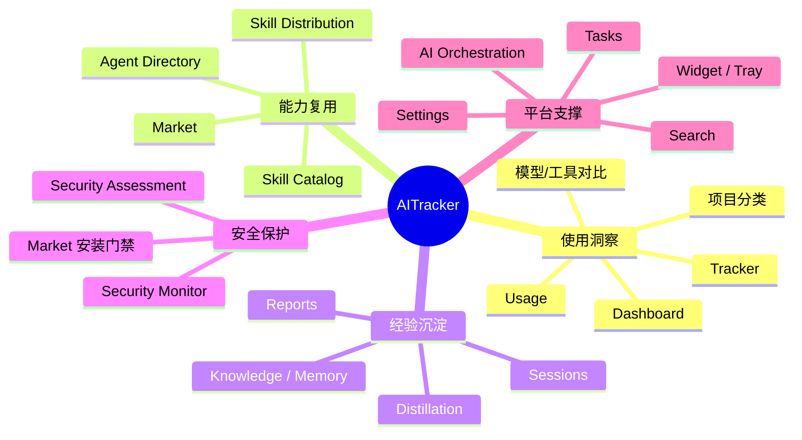
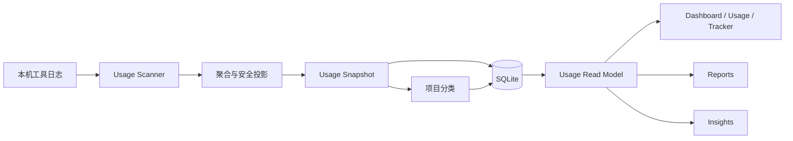
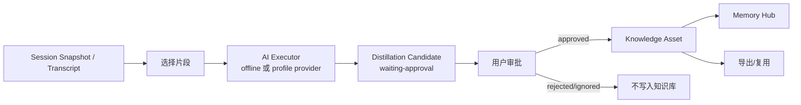

# AITracker 业务结构（当前代码版）

> 本文档从产品能力和业务模块视角梳理当前仓库。
> 运行时细节见 [`system-architecture.zh-CN.md`](system-architecture.zh-CN.md)。

## 1. 产品定位

AITracker 是一个本地优先的 AI 工作台，目标是把散落在多个 AI 编程工具里的使用记录、模型成本、Skills、会话经验、知识、报告和安全评估收敛到统一本地平台。

产品要回答四类问题：

1. AI 用量与成本去了哪里？
2. 哪个工具、模型或项目更适合当前工作？
3. 哪些 Skill、经验和方法可以跨工具复用？
4. 如何把历史会话沉淀成长期记忆、知识资产和报告？

## 2. 业务能力地图



## 3. 模块目录

当前 `src/app/module-catalog.source.json` 注册了 17 个业务模块：

| 模块 ID | 路由 | 能力 | 业务含义 |
|---|---|---|---|
| `dashboard` | `/` | `read-dashboard` | 汇总使用量、趋势、工具和项目状态 |
| `usage` | `/usage` | `read-usage` | 使用量、Token、成本和聚合分析 |
| `tracker` | `/tracker` | `read-usage` | 使用趋势与高消耗视图 |
| `agent-directory` | `/sources` | `read-agents` | 本机 AI 工具目录和数据目录 |
| `skill-catalog` | `/agents` | `read-skills` | 工具 Skills、Agent 使用和安全视图 |
| `skill-distribution` | `/skills` | `install-skills` | Skill Hub 与跨工具安装/卸载 |
| `distillation` | `/distill` | `run-distillation` | 从会话提炼候选经验 |
| `knowledge` | `/knowledge` | `read-knowledge` | 知识/记忆资产 |
| `reports` | `/reports` | `generate-reports` | 日/周/月报告 |
| `security-assessment` | `/security/assessment` | `scan-security` | Skills/资产安全评估 |
| `security-monitor` | `/security/monitor` | `monitor-security` | 安全状态监控 |
| `search` | `/search` | `search-local-data` | 本地数据安全搜索 |
| `projects` | `/projects` | `read-projects` | 项目视图与归属 |
| `insights` | `/insights` | `read-insights` | 页面级洞察 |
| `optimization` | `/optimization` | `propose-optimization` | 优化建议 |
| `tasks` | `/tasks` | `configure-tasks` | 后台任务配置 |
| `settings` | `/settings` | `manage-settings` | 存储、模型、语言、更新等设置 |

另有 `ai-orchestration`、`sessions`、`sources`、`widget`、`monitoring` 等在模块目录中承担基础设施、数据源或展示职责。

## 4. 核心业务流

### 4.1 使用量采集与成本分析

**目标**：从本机 AI 工具日志计算 Token、成本、模型、项目和趋势。



关键事实：

- 采集每 5 分钟刷新，但只在快照过期时启动。
- Scanner 禁网，只读本机数据。
- 采集失败或超时会保留 last-known-good 快照，并把本次结果标记为 stale-refreshed。
- 项目引用会交给增量分类器，Dashboard 查询读取持久化分类索引。
- 工具使用/会话证据如果缺少安装事实，会触发一次安装探测，而不是等待下一次整点扫描。

### 4.2 工具发现与注册表

工具注册表位于 `src/lib/tool-registry`。生成后的公开清单当前包含 36 个工具，例如 Claude Code、Codex、Cursor、Gemini CLI、OpenCode、OpenClaw、GitHub Copilot、Roo Code、Zed Agent、Goose、Droid、Cline、Qwen CLI、DeepSeek Harness、Cherry Studio 等。

每个工具声明：

- 平台支持；
- 使用量能力：`native` 或 `adapter`；
- Skills 能力：读写、只读或 unsupported；
- 会话能力：resume、read 或 unsupported；
- Market 能力：install-target 或 unsupported；
- 安全能力。

这让 Sources、Usage、Skills、Market 和安全模块共享同一份工具能力事实，避免各页面重复判断。

### 4.3 会话恢复与经验提取

会话流程分三步：

1. **发现与快照**：server 端扫描本地会话记录，生成 Session Snapshot。
2. **查看与恢复**：`/chats` 展示会话，可走受控 resume executor。
3. **蒸馏候选**：Distillation Workbench 选中会话或片段，生成候选经验。

会话恢复不是直接执行任意命令；组合根使用 registry-owned tokenized command，并且不通过 shell 展开用户输入。

### 4.4 Skills 蒸馏



规则：

- 真实模型请求先原子预扣配额。
- 真实模型失败不会伪造“蒸馏成功”。
- 候选必须等待用户审批。
- 审批后才写入知识库。
- 内容经过安全过滤，不直接保存原始会话。
- 当前组合根尚未接入资产安全评估，缺失 verdict 按 unknown 处理，不视为 clean。

### 4.5 Knowledge / Memory

Knowledge 是蒸馏和长期记忆的落点。

状态机：

```text
draft -> approved -> published -> archived
```

业务规则：

- 资产有 kind、标题、版本、内容 hash、provenance 和安全 verdict。
- 相同内容 hash 可用于重复建议。
- 标题、source ref 和 provenance 摘要会拒绝明显凭证值。
- Memory Hub 展示蒸馏出的 persona/profile、task memory、brief、snippet 等资产。

### 4.6 Skills 目录与跨工具分发

Skill Catalog 负责发现、过滤和查看本机 Skills。Skill Distribution 负责安装计划。

安装流程：

1. 用户选择 Skill 和目标工具。
2. 创建 Install Plan。
3. 校验目标能力、approval 和包状态。
4. 执行文件系统变更。
5. 记录 Distribution Run 和目标结果。
6. 失败时按计划回滚。

安全规则：

- 包 hash 必须匹配；
- 必须有安全评估；
- 安全 verdict 不允许是 unknown；
- Market/发布路径是 fail-closed，缺评估即 blocked，只有 clean 才允许发布。

### 4.7 Market

Market 提供 Skill/资产市场入口。它依赖外部 Market 服务，但失败时可以使用最近缓存。市场能力由工具注册表控制，只有被标记为 install-target 的工具才可能成为安装目标。

### 4.8 报告

Reports 使用三类输入：

1. Session Snapshot；
2. Usage Snapshot；
3. USD 到本地货币的汇率上下文。

报告可以是固定结构，也可以在用户配置了可执行模型 profile 时附加 AI 摘要。任务目录支持 daily、weekly、monthly 三个计划入口，报告运行、证据和正文保存在 SQLite。

**分析覆盖度（R0–R5 已实施，2026-09-17）**：Q1「用了多少」完整（用量/成本/占比）；Q2「干了什么」已补齐——行为分布（bucket tools 派生近似）与主要会话信号进入 `context.summary`（R1）；Q3「干得怎么样」已补齐——日报正文「亮点与不足」（R2）、`repeated` 重复信号真实计算触发「建议蒸馏」（R3）、周/月报「沉淀与产出」真实计数（R4，产出经 composition root 注入 `ReportOutputPort`，不 import 具体实现）。隐私边界保持 fail-closed：报告不读会话原文、正文与模型输入过 `safeReportText`/`reportSessionTitle` 脱敏。详见 [报告分析设计](../design/aitracker-报告分析设计.md)。

### 4.9 Insights 与优化建议

Insights 是页面级洞察系统：

- 每个 page surface 有证据 adapter；
- 规则生成的洞察始终可用；
- 可选 AI enhancer 只在允许时增强；
- 每 60 分钟刷新一次；
- 洞察缓存保存在 `insight_enhancement_*` 表。

Optimization 模块基于本地使用/会话/项目数据提出优化建议，是洞察层之上的业务展示。

### 4.10 安全评估与监控

安全域包含两条链路：

1. **Electron 扫描链路**：
   用户选择 Skill 目录或目标，`SecurityScannerService` 读取文件并调用 `@estelwalks/agent-threat-scanner`，结果进入安全 IPC、历史和调度。
2. **资产评估链路**：
   Skill/Knowledge/Distillation 资产生成 opaque asset ref、findings、verdict 和 rule version，渲染层只见安全投影。

扫描限额：

| 限制 | 当前值 |
|---|---|
| 单次最大文件数 | 500 |
| 最大目录深度 | 6 |
| 单文件最大 | 1MB |
| 总量最大 | 20MB |
| 历史记录 | 200 |

发布门禁是 fail-closed：没有评估就是 blocked；只有 clean 才能发布。

### 4.11 Settings 与平台支撑

Settings 管理存储用量、语言、货币、主题、模型 profile、更新、自动启动、任务和隐私相关行为。

平台支撑包括：

- `tasks`：后台任务和手动刷新；
- `search`：跨数据域的安全搜索；
- `widget`：桌面 Widget 和托盘；
- `monitoring`：采集器和后台运行心跳；
- `ai-orchestration`：模型 profile、provider 路由、离线兜底和审计。

## 5. 数据所有权与隐私

| 数据 | 归属 | 说明 |
|---|---|---|
| 使用聚合 | 本地 SQLite | 渲染层只读投影 |
| 会话 | 本地工具目录 + 本地快照 | 快照保存安全投影 |
| Skills | 本机工具目录 + 本地快照 | 安装/卸载需要明确计划 |
| Knowledge | 本地 SQLite | 审批后持久化 |
| Reports | 本地 SQLite | 报告运行和证据可追溯 |
| 模型凭据 | 本地加密 secret store | 渲染端不读取原始 key |
| 工具数据目录覆盖 | `tool_data_roots` | 只供 scanner 使用 |
| Market 缓存 | 本地 HTTP cache | 外网失败时可用 |

网络访问只在以下场景出现：

1. Market 和汇率服务；
2. GitHub Releases 更新检查；
3. 用户显式配置的模型 Provider。

本地采集、分析、报告、蒸馏审批、知识管理和设置不需要外网。

## 6. 页面到模块映射

| 页面 | 所属模块 | 主要业务 |
|---|---|---|
| `/` | dashboard | 总览、趋势、工具、项目 |
| `/usage` | usage | 使用量分析 |
| `/tracker` | usage | 燃烧/消耗视图 |
| `/sources` | sources / agent-directory | 工具源、安装状态、数据目录 |
| `/agents` | skill-catalog | Agent/Skill 总览 |
| `/skills` | skill-distribution | Skill Hub |
| `/market` | skill-distribution / market | 市场安装 |
| `/distill` | distillation | 会话蒸馏 |
| `/memory` | knowledge | 记忆与知识 |
| `/knowledge` | knowledge | 知识资产 |
| `/chats` | sessions | 会话列表与恢复 |
| `/reports` | reports | 报告 |
| `/security` | security-assessment / security-monitor | 安全 |
| `/search` | search | 搜索 |
| `/projects` | projects | 项目 |
| `/insights` | insights | 洞察 |
| `/optimization` | optimization | 优化 |
| `/tasks` | tasks | 任务 |
| `/settings` | settings | 设置 |
| `/widget` | widget | 桌面 Widget |

## 7. 用户旅程

### 7.1 新用户

1. 安装并打开 AITracker。
2. Sources 页确认工具安装和数据目录。
3. 后台刷新 Usage、Sessions、Skills、Installations。
4. Dashboard 查看总览。
5. 需要时在 Settings 配置模型和语言。

### 7.2 成本分析

1. 打开 Dashboard/Usage。
2. 按时间、工具、模型、项目过滤。
3. 查看趋势、消耗和高成本来源。
4. 生成报告或导出。

### 7.3 经验复用

1. 打开 Sessions/Distill。
2. 选择会话或片段。
3. 蒸馏生成候选。
4. 审批后进入 Knowledge/Memory。
5. 下一次工作复用经验。

### 7.4 Skill 复用

1. Skill Catalog 或 Market 查找 Skill。
2. 查看安全评估。
3. 选择目标工具。
4. 创建安装计划并执行。
5. Sources/Agent Overview 验证安装状态。

### 7.5 安全检查

1. 打开 Security。
2. 选择 Skills/资产或依赖自动扫描计划。
3. 查看扫描结果、风险和历史。
4. Market/发布路径按 clean 门禁放行或阻止。

## 8. 术语表

| 术语 | 定义 |
|---|---|
| Snapshot | 某类本地数据的持久化只读快照 |
| Last-known-good | 扫描失败时继续展示的上一次健康快照 |
| Stale-refreshed | 本次刷新失败但返回旧快照的状态 |
| Tool Registry | AI 工具平台/路径/能力清单 |
| Candidate | 蒸馏产生、等待审批的经验候选 |
| Knowledge Asset | 审批后的知识/记忆资产 |
| Security Verdict | 安全评估结论：clean/suspicious/dangerous/unknown |
| Composition Root | 服务端模块和运行时的装配点 |
| Server Function | TanStack Start 暴露给前端的受控服务端调用 |

## 9. 当前边界

1. 不承诺把所有 AI 工具的所有原始会话内容完整入库；系统优先保存安全投影和聚合。
2. Skills 安装依赖目标工具能力，不是所有工具都支持读写或 Market。
3. Linux 能力多数仍是 planned。
4. 蒸馏资产的安全评估接线仍在后续计划中。
5. Electron 安全扫描与服务端任务运行时保持分离，避免重复或弱化扫描路径。
