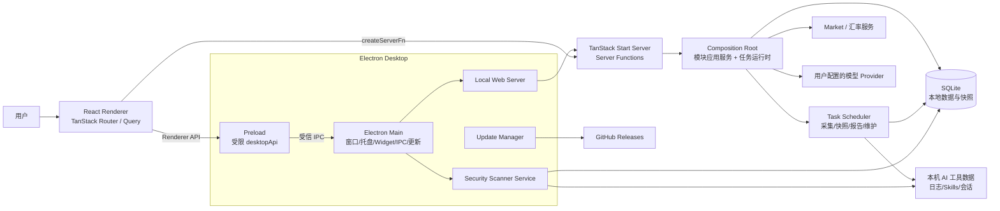

# AITracker 系统架构（当前代码版）

> 本文档描述当前仓库的真实运行结构，适合新成员和后续开发前阅读。
> 多渠道安装与发布的专项设计见 [`docs/design/aitracker-架构设计文档.md`](../design/aitracker-架构设计文档.md)。

## 1. 架构总览

AITracker 是一个本地优先的 AI 工作台。它用 Electron 提供桌面壳，用 TanStack Start/React 提供渲染层与服务器函数层，用 SQLite 保存本地快照、任务、知识、报告和安全结果。



## 2. 技术栈与运行形态

| 层 | 当前实现 | 说明 |
|---|---|---|
| 桌面壳 | Electron | 负责窗口、托盘、Widget、自动更新、安全扫描 IPC、单实例锁和启动屏障 |
| 渲染层 | React 19 + TanStack Router + TanStack Query | 页面路由、加载器、组件查询和局部状态 |
| 服务器层 | TanStack Start / Vite SSR | 承载模块 server functions 和页面 loader |
| 状态管理 | TanStack Query + React Context | 未使用 Pinia/Vue；React Context 用于主题、i18n 等全局横切状态 |
| 本地存储 | SQLite | 快照、任务、报告、知识、安全结果、模型配置等统一落库 |
| 数据采集 | Node 服务端 scanner | 只读取本机 AI 工具日志、会话和 Skills 目录 |
| 安全扫描 | Electron 内 `SecurityScannerService` + `@estelwalks/agent-threat-scanner` | 管理扫描目录、限额、结果和历史 |
| 构建 | Vite、TypeScript、electron-builder | Web 产物进入 `.output`，Electron 产物进入 `build/electron` |

环境要求来自根清单：Node.js 24+、npm 10+，完整桌面体验面向 macOS 与 Windows；Linux 在工具/模块清单中目前是 `planned`。

## 3. 仓库边界

```text
electron/              Electron 主进程、preload、本地 Web 服务、更新、托盘、安全扫描
src/app/               应用装配层：composition root、启动屏障、运行时策略、模块目录
src/routes/            TanStack Router 文件路由
src/modules/           业务模块，按 application/domain/infrastructure/presentation 分层
src/lib/               本地使用量扫描、工具注册表、i18n、主题、定价、配置等共享逻辑
src/platform/          数据库、发现、观测、持久化、运行时等平台能力
packages/cli/          安装器 CLI 与发布辅助工具
docs/                  用户与开发文档
docs/architecture/     当前代码架构与业务结构文档
```

前端代码不得直接访问文件系统和 SQLite；服务器代码不得进入客户端 bundle。Vite 的 `importProtection` 会把 `server-only` 和服务端目录泄露视为错误。

## 4. 启动链路

1. Electron 建立启动窗口，先显示与 HTTP 应用无关的启动页，避免冷启动黑屏。
2. Electron 启动 `LocalWebServer`，生产模式服务 `.output/public` 的静态资源，并把请求交给 TanStack Start server entry。
3. `src/server.ts` 包装 TanStack server entry，捕获启动错误并渲染稳定错误页；`/api/security` 转发给 Electron 安全 HTTP API。
4. 首次 SSR 请求触发 `ensureBackgroundRuntimeStarted()`，按平台策略决定是否启动后台任务。
5. `getCompositionRoot()` 惰性构建组合根：
   - 打开 SQLite；
   - 执行 `PRAGMA quick_check` 和迁移；
   - 必要时先生成迁移前备份；
   - 注册 usage/session/skill/installation/WSL snapshot runtime；
   - 组装任务调度器、AI 执行器、报告、蒸馏、知识、搜索、洞察和监控服务。
6. 页面查询只读取快照与已投影 read model，不直接扫描原始日志。

## 5. Electron 与 Web 的边界

### 5.1 Electron Main

`electron/main.ts` 负责主窗口、Widget 窗口、托盘、菜单、语言/货币偏好、自动启动、自动更新、安全扫描调度、电源事件、数据重置和受信 IPC。

受信 IPC 通过 `assertTrustedSender()` 校验 WebContents ID，防止不可信渲染端调用桌面能力。

### 5.2 Preload

`electron/preload.cts` 只通过 `contextBridge` 暴露受限的 `desktopApi`，包括窗口控制、偏好、语言、货币、Widget、托盘标题、安全扫描目标/任务/历史/计划、更新状态等。

### 5.3 Local Web Server

生产模式不是把完整 Node 服务开放到公网，而是由 Electron 内部本地 Web 服务承载页面和 server functions。它设置同源、CSP、token cookie、请求体大小限制和安全响应头。

## 6. 组合根与任务运行时

组合根位于 `src/app/composition.server.ts`，是服务端模块的唯一装配点。

### 6.1 主要服务

| 服务 | 作用 |
|---|---|
| `databaseRuntime` | SQLite 生命周期、迁移、健康检查、关闭钩子 |
| `scheduler` / `taskApi` | 后台任务调度、手动刷新、运行记录 |
| `usageSnapshot` | 使用量快照采集、缓存、last-known-good、刷新 |
| `sessionSnapshot` | 会话快照读取与刷新 |
| `skillSnapshot` | Skills 快照与最近使用证据 |
| `installationSnapshot` | 工具安装事实快照 |
| `wslSnapshot` | Windows WSL 拓扑共享快照 |
| `classificationService` | 项目分类索引 |
| `searchIndex` | 本地安全投影搜索 |
| `aiExecutor` | 模型调用路由、离线兜底、执行审计 |
| `reports` | 使用上下文、AI 摘要和报告生成 |
| `distillation` | 候选生成、审批和知识写入 |
| `knowledge` | 记忆/知识版本与状态 |
| `insights` | 页面洞察规则结果与可选 AI 增强 |
| `monitoring` / `metrics` | 心跳、只读观测指标 |

### 6.2 定时任务

运行时策略由 `src/app/runtime-policy.source.json` 生成。核心任务包括：

| 任务 | 默认节奏 | 说明 |
|---|---|---|
| `usage.refresh` | 每 5 分钟 | 扫描本地使用量，禁网，超时 15 分钟 |
| `sessions.refresh` | 每 5 分钟 | 刷新会话快照，禁网 |
| `skills.refresh` | 每 30 分钟 | 刷新 Skills 快照，禁网 |
| `installation.refresh` | 每 60 分钟 | 刷新工具安装事实，禁网 |
| `insights.refresh` | 每 60 分钟 | 刷新页面洞察 |
| `exchange.refresh` | 每 24 小时 | 刷新汇率，允许网络，失败保留旧值 |
| `retention.apply` | 每天 03:00 | 数据保留策略 |
| `backup.daily` | 每 24 小时 | 本地备份 |
| `reports.generate.*` | 用户配置的日/周/月计划 | 生成报告 |

所有快照任务都有 single-flight、超时、重试和 last-known-good 策略。页面触发刷新也会走任务 API，而不是绕过调度器重新扫描。

## 7. 数据架构

### 7.1 存储位置

默认数据根是 `~/.aitracker`。桌面平台可能使用平台相关数据目录。用户可以在 Sources 页面为单个工具选择数据目录，覆盖值保存在 `tool_data_roots`。

### 7.2 数据域

| 数据域 | 代表表 |
|---|---|
| 快照版本 | `snapshot_blobs`, `snapshot_generations`, `snapshot_heads`, `snapshot_warnings` |
| 使用量 | `usage_events`, `usage_sources`, `usage_aggregate_*`, `usage_daily_aggregates`, `usage_event_*` |
| 会话 | `sessions`, `session_daily_density`, `session_unknown_models` |
| Skills | `skills`, `skill_installations`, `skill_blacklist` |
| 工具安装 | `agent_installations`, `agent_installation_paths` |
| 项目 | `project_classifications` |
| 知识 | `knowledge_assets`, `knowledge_versions`, `knowledge_metadata`, `knowledge_provenance` |
| 蒸馏 | `distillation_candidates`, `distillation_candidate_sessions` |
| 报告 | `reports`, `report_runs`, `report_assets`, `report_evidence` |
| 安全 | `security_assessments`, `security_findings`, `security_scan_runs` |
| 模型与审计 | `model_profiles`, `ai_executions`, `ai_daily_usage` |
| 任务与偏好 | `task_preferences`, `task_runs`, `app_preferences`, `runtime_flags` |
| 工具目录覆盖 | `tool_data_roots` |

### 7.3 隐私原则

- 核心采集、分析、Skills、知识、报告和设置本地保存，不需要账号。
- 使用量、Skills、Sessions、Installation 扫描在运行时策略中均为禁网。
- 聚合和快照保存安全投影；渲染层 read model 不直接暴露原始会话内容。
- 用户选择的数据目录只用于指向本地 scanner，不进入摘要、洞察或网络请求。
- Market、汇率、更新检查、模型调用是显式网络功能；Market/汇率失败时走缓存或内置兜底。
- Provider 凭据保存在本地加密 secret store，渲染端读取的是 key-free projection。

## 8. 前端架构

### 8.1 Provider 与状态

`src/app/providers.tsx` 是全局 provider 的唯一装配点：

```tsx
QueryClientProvider
  └── I18nProvider
        └── ThemeProvider
```

当前状态策略：

- 服务器数据：TanStack Query + TanStack Router loader；
- 路由状态：TanStack Router；
- 主题、语言、货币：React Context；
- 业务模块间共享状态：优先共享服务端快照/read model；
- 本仓库没有 Pinia、Vue、Redux、Zustand 或 Jotai。

### 8.2 页面与导航

侧边栏主入口来自 `src/components/AppShell.tsx`：

| 路由 | 名称 |
|---|---|
| `/` | Home Overview |
| `/agents` | Agent Overview |
| `/distill` | Distillation Workbench |
| `/memory` | Memory Hub |
| `/reports` | Reports |
| `/chats` | Session Resume |
| `/skills` | Skill Hub |
| `/security` | Security |
| `/market` | Market |
| `/tracker` | Burning List / Tracker |

此外还有 `/sources`、`/settings`、`/usage`、`/projects`、`/insights`、`/optimization`、`/tasks`、`/search`、`/knowledge`、`/widget` 等模块路由。

### 8.3 Server Functions

模块通过 `createServerFn` 暴露服务端查询/变更能力。页面和 server functions 都必须经过应用服务层，不能直接访问数据库私有 API。

## 9. 质量与验证

开发前使用：

```bash
npm ci
npm run dev:desktop
```

关键验证命令：

```bash
npm run typecheck
npm run lint
npm run test:all
npm run build:desktop
```

更完整的测试矩阵见 [`docs/DEVELOPMENT.md`](../DEVELOPMENT.md)。

## 10. 当前架构约束与已知边界

1. 完整桌面体验目前面向 macOS 和 Windows；Linux 在清单中是 planned。
2. 组合根中蒸馏审批目前没有接线安全评估，生成的候选缺少 verdict 时按 unknown 处理，不会当作 clean。这是源码中显式记录的后续事项。
3. 服务端任务运行时不承接 Electron 安全扫描；手动/自动扫描走 Electron 安全 IPC，避免出现较弱的后台扫描旁路。
4. 大量本机文件读取依赖用户安装的 AI 工具和其真实数据目录，因此采集结果天然受工具版本、日志格式和平台差异影响。
5. Node 24 是运行要求；本仓库的工具链和生成器假定较新的 Node/npm 环境。
