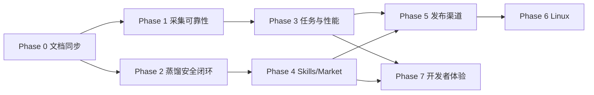

# AITracker 后续开发计划（基于当前代码）

> 本计划以当前仓库事实为基础，优先补齐会影响正确性、隐私、可维护性和发布稳定性的工作。
> 多渠道发布的既有计划见 [`aitracker-敏捷任务清单.md`](aitracker-敏捷任务清单.md)。

## 1. 当前状态摘要

| 领域 | 当前状态 | 结论 |
|---|---|---|
| 桌面运行时 | Electron + 本地 Web Server + TanStack Start 已成型 | 保持边界，避免渲染端直接触碰文件系统/SQLite |
| 数据存储 | SQLite + snapshot generations + 迁移备份 | 数据层较完整，继续以快照/read model 为主 |
| 使用量采集 | 36 个工具注册、5 分钟本地扫描、禁网策略 | 优先处理兼容性和性能预算 |
| 任务运行时 | single-flight、超时、重试、last-known-good 已建立 | 新功能必须走同一任务 API |
| Skills | 发现、安装计划、hash、安全评估、发布门禁已有 | 蒸馏到 Skill 的安全接线仍是缺口 |
| 蒸馏与知识 | 候选、审批、knowledge 状态机、配额与审计已有 | 安全 verdict 接线是明确后续 |
| 安全 | Electron scanner + 资产评估 + fail-closed 门禁 | 保持 Electron 与服务端不重复扫描 |
| 发布 | Draft prerelease、metadata、checksums、CLI 生成器已有 | 稳定签名与真实渠道发布仍是核心门槛 |
| 前端状态 | React Query + React Context，无 Pinia | 不建议迁 Vue/Pinia；继续用 Query + Context |
| 平台 | macOS/Windows 完整支持，Linux planned | Linux 应作为后续独立阶段 |

## 2. 总体原则

1. **本地优先不变**：本地扫描保持禁网；网络能力必须显式声明。
2. **快照优先**：页面读 SQLite snapshot/read model，不直接扫描原始文件。
3. **任务单入口**：定时刷新、手动刷新和模块间联动都走 Task API。
4. **安全 fail-closed**：缺评估不是 clean；unknown 不能发布或安装。
5. **保持现有栈**：React + TanStack Query/Router，不引入 Vue/Pinia。
6. **服务端装配收敛**：新模块接入 Composition Root，不建第二个隐式服务容器。
7. **平台能力受清单控制**：新增工具或平台先更新 registry/runtime policy，再写业务逻辑。

## 3. 阶段规划

### Phase 0：架构事实与文档同步（当前）

**目标**：把当前业务结构、架构边界和后续计划文档化，减少后续开发的认知成本。

任务：

- [x] 梳理运行时边界。
- [x] 梳理模块目录与业务流。
- [x] 记录任务与快照策略。
- [x] 记录隐私、安全和网络边界。
- [ ] 将新文档加入团队 PR checklist。
- [ ] 后续每次新增模块时同步 `module-catalog` 与业务结构文档。

验收：

- 新成员能从文档理解 Electron/Web/数据库/任务/安全边界。
- 文档不引用未实现能力。
- 模块变化时能找到需要同步的文件。

### Phase 1：数据一致性与采集可靠性

**目标**：让本机工具兼容、项目归属和快照状态更可信。

优先级：P0

任务：

1. 建立工具 reader 兼容矩阵
   - 覆盖 36 个 registry 工具；
   - 记录工具版本、日志位置、格式、平台差异和已知缺口。
2. 统一采集诊断
   - 差异化展示“未安装 / 已安装但无日志 / 格式不识别 / 超时 / 权限错误”。
3. 加强项目归属测试
   - 覆盖真实项目路径、符号链接、Windows 盘符、WSL 路径和自定义数据目录。
4. 快照质量指标
   - 记录扫描成功源数、失败源数、超时、last-known-good 命中次数。
5. 性能预算
   - 大目录 fixture 下验证 5 分钟 usage/session 刷新不阻塞首屏。

验收：

- 任一工具采集失败都有用户可理解的诊断。
- 采集失败不会覆盖健康快照。
- 大目录刷新满足现有路由打开性能预算。
- 项目归属测试覆盖 macOS 和 Windows。

### Phase 2：蒸馏、知识与安全闭环

**目标**：把蒸馏结果从“可用候选”推进到“可安全复用的知识资产”。

优先级：P0

任务：

1. 接通蒸馏资产安全评估
   - 候选生成时携带资产评估引用；
   - 审批前展示 verdict；
   - 缺评估显示 unknown，不显示 clean；
   - 高风险候选阻止写入知识。
2. 明确 Skill 产物门禁
   - Distillation 产生的 brief/skill/prompt 类候选在发布或安装前必须通过评估。
3. Knowledge 版本审计增强
   - 记录蒸馏来源、模型、prompt 能力类别、审批人和安全结论。
4. 敏感信息过滤回归测试
   - API key、Bearer token、路径、邮箱、凭证值和项目内网地址。
5. 蒸馏失败语义
   - 真实模型失败、配额不足、审批中断、内容过滤都要有稳定错误码。

验收：

- 只有 clean 资产能进入发布/安装路径。
- unknown 不等于 clean。
- 用户能在审批前看到风险摘要。
- 原始会话内容不因蒸馏被意外入库。

### Phase 3：后台任务与性能

**目标**：提升长会话、大数据目录和多任务并发下的稳定性。

优先级：P1

任务：

1. 观测任务队列
   - 输出每类任务的等待、执行、超时、重试和 last-known-good 指标。
2. 改进重负载调度
   - 为 usage、sessions、skills、installation 保留清晰队列隔离。
3. 降低重复刷新
   - 快照 freshness 与用户操作触发的刷新合并，避免同一入口重复跑。
4. 补齐崩溃恢复
   - 模拟数据库锁、迁移中断、进程退出和备份恢复。
5. Widget 性能
   - Widget/托盘读取不触发重扫描，只读缓存快照。

验收：

- 页面和后台刷新共享 single-flight。
- 任何重任务不能拖住首屏路由。
- 崩溃后应用能进入健康或可恢复状态。

### Phase 4：Skills、Market 与跨工具复用

**目标**：提升 Skills 安装的安全性和可逆性。

优先级：P1

任务：

1. 安装计划预览
   - 安装前展示目标路径、冲突、覆盖文件和回滚范围。
2. 目录边界加固
   - 继续覆盖 realpath、symlink、权限、路径逃逸和并发写。
3. Market 缓存一致性
   - Market/汇率失败时显示数据新鲜度和 fallback 来源。
4. 安装结果诊断
   - 差异化 unsupported tool、目标目录不可写、hash mismatch、assessment mismatch、回滚成功/失败。
5. 跨工具能力测试
   - 按 registry capabilities 测试 install-target/read-write/read-only/unsupported。

验收：

- 不支持的工具不能进入安装计划。
- 安装失败可回滚。
- 安全门禁始终先于文件写入。

### Phase 5：发布与稳定渠道

**目标**：完成从 draft prerelease 到稳定渠道的发布闭环。

优先级：P1

任务：

1. 完成 npm CLI 真实发布验证。
2. 完成 Homebrew Tap/Cask 真实用户环境验证。
3. 完成 WinGet manifest 与升级路径验证。
4. 获得 macOS Developer ID 与公证能力。
5. 获得 Windows Authenticode 签名能力。
6. 建立发布状态矩阵与回滚演练。
7. 保持 stable/beta 频道隔离。

验收：

- 正式渠道只能消费签名稳定制品。
- beta 不影响 stable 用户。
- checksum/metadata 必须先验证后安装。
- 任何渠道失败不会产生部分发布。

详细任务跟踪继续使用 [`aitracker-敏捷任务清单.md`](aitracker-敏捷任务清单.md)。

### Phase 6：Linux 与平台扩展

**目标**：在核心能力稳定后评估 Linux 支持。

优先级：P2

任务：

1. 盘点 Linux 工具路径与日志格式。
2. 评估 tray、widget、secret store、auto-update 差异。
3. 为 `tool_data_roots` 和 registry platform 增加真实 Linux fixture。
4. 定义 Linux E2E 最小集。
5. 决定 Electron 打包格式（AppImage/deb/rpm/Flatpak）。

验收：

- 不在文档中承诺未验证的 Linux 能力。
- Linux 支持范围、安装方式和不支持项明确。

### Phase 7：开发者体验与代码治理

**目标**：让大仓库继续可维护。

优先级：P2

任务：

1. 模块边界检查
   - 阻止 presentation 直接依赖 SQLite/文件系统。
   - 阻止跨模块绕过应用服务层。
2. 契约测试
   - 为 server functions 增加输入/输出/错误码契约。
3. 生成物防护
   - 继续验证 route tree、module catalog、runtime policy、tool manifest 生成物。
4. 文档触发器
   - 新增模块、任务、工具、迁移表时必须更新对应文档。
5. 大型测试拆分
   - 将超长 scanner/迁移测试拆成可定位的子套件。

验收：

- 架构规则由脚本验证，不仅靠 review。
- 生成物漂移在 CI 中失败。
- 新模块有模板和 checklist。

## 4. 风险与优先级

| 风险 | 影响 | 处理 |
|---|---|---|
| 工具日志格式变化 | 使用量/会话缺失 | reader 兼容矩阵 + fixture 回归 |
| 原始内容误入库 | 隐私风险 | scanner 投影测试 + 蒸馏过滤测试 |
| 安全评估缺位 | 恶意 Skill 被复用 | unknown 非 clean + fail-closed 门禁 |
| 采集重扫阻塞 UI | 体验下降 | 快照读取 + 队列隔离 + 性能预算 |
| 数据目录配置错误 | 无法采集 | 校验、诊断和恢复引导 |
| 未签名稳定版被误用 | 安全/信任风险 | stable/beta 频道隔离 + checksum |
| 生成物与源定义漂移 | 架构失控 | CI 生成校验 |
| 文档滞后 | 重复踩坑 | 模块/任务/工具变更触发文档更新 |

## 5. 建议执行顺序

短期建议先做两件事：

1. **蒸馏安全评估接线**：这是当前源码里明确记录的 TODO，直接影响知识资产安全。
2. **工具 reader 兼容矩阵**：这是本地采集的核心风险，直接影响所有用量/会话/项目分析。

## 6. 完成定义

一个阶段完成必须满足：

- 代码通过 `npm run typecheck`、`npm run lint`、相关测试。
- 涉及数据库的改动通过 `npm run test:database`。
- 涉及采集的改动有 fixture/回归测试。
- 涉及安全的改动覆盖 unknown、suspicious、dangerous、missing assessment。
- 涉及新任务/工具/迁移表时同步 runtime policy、catalog 和文档。
- 不引入未声明的网络访问。
- 渲染端只使用安全 read model。
